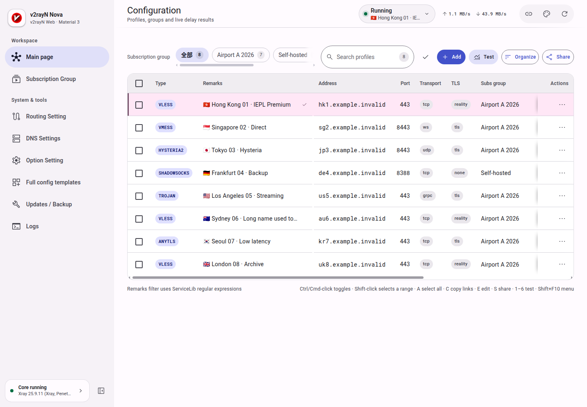
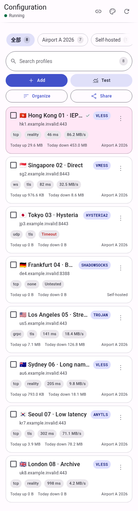

# v2rayN WebUI Nova

Nova is an independent, modern WebUI for the v2rayN Web API. It keeps the existing business
layer, API contract and security model while replacing the entire presentation layer with a
Material Design 3 application shell.

It is **not** part of the API contract: the backend does not require Vue, Vite, Node.js or this
UI to start. Nova pairs with a `v2rayN.WebAPI` build that exposes the required capabilities
(`auth.sessions`, `events.sse`, `editor.options`, `profiles`, `subscriptions`, `routing`, `dns`,
`settings`, `backup.restore`, `core.runtime`, `core.updates`, `WebAPI.self-update`).

<p align="center">
  
  
</p>

## Highlights

- **Material Design 3 everywhere** — semantic color roles, typography, shape, elevation, state
  layers and motion come from one token layer (`Src/Design/tokens.css`); feature components do
  not carry private palettes, radii or shadows.
- **A desktop rail** — a persistent, collapsible navigation rail with runtime status, theme and
  language menus, and a scrollable advanced section. It collapses to icons and tooltips between
  861 and 1100 px.
- **A genuinely mobile layout** — a floating glass three-tab bar (Nodes / Subscriptions / More),
  safe-area padding, touch targets, mobile cards and a guarded floating Back button. The tab bar
  hides when the on-screen keyboard makes the viewport too short.
- **One business state** — pages and dialogs read the shared `NovaApp` context. Requests,
  sessions, SSE, drafts and race protection are not duplicated per page.
- **URL-addressable navigation** — every page has a canonical `#/page` hash, history entries,
  deep-link recovery and a single unsaved-changes guard shared by in-app and browser Back.
- **Accessible by construction** — keyboard-operable menus and dialogs, focus traps and return
  focus, visible focus rings, labelled icon controls, reduced-motion and forced-colors policies,
  and a skip link to the workspace.
- **Local Liquid Glass** — translucent, blurred material only on the floating navigation, the Back
  button and transient surfaces. Opaque, reduced-transparency, high-contrast, forced-colors and
  reduced-motion fallbacks are built in.

Everything from the previous WebUI remains available: node CRUD, search, groups, batch
selection/moves, TCP/real-ping/speed/UDP/mixed tests, subscriptions, routing profiles and rules,
DNS profiles, global settings, Core templates, Core lifecycle and updates, logs, backup/restore,
localization (zh-CN / zh-TW / en-US), theme preferences and SSE events.

## Requirements

- **Node.js 22.18 or newer** and npm for development and building. The repository uses Node's
  native TypeScript type stripping; CI builds and tests with Node 24.
- A compatible `v2rayN.WebAPI` backend (or historical `v2rayN.Web`) for real data. No backend is
  bundled with this repository.
- Any static file server for production. The deployed artifact has no Node.js runtime
  dependency.

## Quick start

```sh
npm ci
npm run dev
```

Vite serves the UI and proxies `/api` to `http://127.0.0.1:5080` by default. Point the proxy at a
different backend with:

```sh
VITE_API_TARGET=http://192.168.1.10:5080 npm run dev
```

Production build:

```sh
npm run build
```

The deployable artifact is `dist/`. Copy its **contents** to any static web server; Vite uses
`base: './'`, so the UI also works from a subpath without rebuilding.

## Connect to the API

On the signed-out screen, leave the backend address empty for same-origin, or enter an absolute
HTTP(S) base URL and use **Test connection** / **Use address**. Examples:

- `http://127.0.0.1:5080`
- `http://192.168.1.10:5080`
- `https://v2rayn-api.example.com`
- `https://gateway.example.com/v2rayn`

Do not append `/api`. Trailing slashes, default ports and host/scheme casing are normalized;
credentials, query strings, fragments, whitespace and non-HTTP(S) schemes are rejected.

For a deployment default, edit `webui-config.js` in the build output:

```js
window.__V2RAYN_WEBUI_CONFIG__ = { apiBaseUrl: 'http://127.0.0.1:5080' }
```

A saved user selection overrides this default. When the UI is hosted independently, the backend
must allow the exact WebUI origin (scheme, host and port) through
`V2RAYN_WEB_ALLOWED_ORIGINS`; first-run setup remains loopback-only. See
[`docs/api.md`](docs/api.md) for the authentication, session, CORS and setup rules.

## Deployment

### Static hosting

Serve the contents of `dist/` with any static server and route unknown paths back to
`index.html`. The application uses hash routing, so deep links always resolve to the same entry
file.

A typical reverse proxy keeps the UI and API same-origin:

```text
https://v2rayn.example.com/          -> dist/
https://v2rayn.example.com/api/*     -> http://127.0.0.1:5080/api/*
```

The API itself never serves the WebUI. Keep the API behind HTTPS and a firewall or VPN when it is
reachable beyond loopback.

### GitHub Pages

[`.github/workflows/pages.yml`](.github/workflows/pages.yml) deploys every push to `main` (and
manual `workflow_dispatch` runs) to GitHub Pages. The job installs dependencies, runs the test
suite and builds with Vite before uploading `dist/`; a failed test or build blocks the deployment.

Enable **Settings → Pages → Build and deployment → Source: GitHub Actions** once in the
repository. Pages serves the project under a subpath, which is supported by Vite's relative
`base: './'` and the hash router. Because Pages is static, select a backend address on the
sign-in screen or set `apiBaseUrl` in `webui-config.js` after deployment.

## Architecture

```text
Src/
├─ App.vue                 application wiring and lifecycle
├─ main.ts                 Vue bootstrap
├─ App/context.ts          one typed provide/inject application context
├─ Composables/            API client, sessions, SSE and business state
├─ Features/
│  ├─ Nodes/               toolbar, desktop table, mobile cards, context menu
│  ├─ Profiles/            editor sections and node action adapter
│  ├─ Subscriptions/       subscription feature UI
│  ├─ Routing/             route profiles, rules, raw editor, modals
│  ├─ Dns/ Settings/ …     feature-specific editors
│  └─ Maintenance/ Logs/   update, backup and log surfaces
├─ Pages/                  lazy page compositions
├─ Shell/                  app shell, rail, top bars, glass tabs, Back button
├─ Components/Material/    reusable MD3 primitives (dialog, menu, checkbox, icons …)
├─ Design/                 tokens and modular CSS (base, components, shell)
└─ UI/                     presentation helpers (requests, drafts, focus, feedback)
```

Rules of the rewrite:

1. The API layer and Composables remain the single source of business truth.
2. Pages receive the shared context; they never instantiate API clients or sessions.
3. CSS is split by concern (tokens, base, buttons, fields, collections, overlays, feedback,
   layout, sidebar, topbar, mobile, glass) and imported through `style.css` / `shell.css`.
4. Feature components stay small and compose shared Material primitives.
5. User-visible strings live in the three locale files; no component owns a private translation
   table.

## Scripts

| Command | Purpose |
| --- | --- |
| `npm run dev` | Vite development server with the `/api` proxy |
| `npm run build` | Locale check, typecheck and production bundle |
| `npm run preview` | Preview the production bundle locally |
| `npm test` | Node test suite (business, source-contract and layout tests) |
| `npm run typecheck` | `vue-tsc` plus the Node/tooling TypeScript project |
| `npm run typecheck:node` | Tooling TypeScript only |
| `npm run check-locales` | zh-CN / zh-TW / en-US schema and UI key coverage |
| `npm run icons` | Regenerate the icon path registry |
| `npm run theme` | Regenerate the Material color token set |

All scripts under `Scripts/` are TypeScript and run through Node's native type stripping; there
is no separate build step for tooling.

## Testing

`npm test` runs an isolated Node test suite with no live backend. It covers:

- session/login/setup contracts and backend switching;
- SSE batching, log queues, operation refreshes and speed-test merges;
- node selection, movement, payload normalization, routing/settings/DNS payloads;
- route history, deep links, dirty guards and mobile Back behavior;
- design-token completeness, glass fallbacks and responsive shell structure;
- reduced-motion and disclosure-animation contracts;
- settings/subscription save flows and editor parity.

Browser tests under `Tests/browser/` are optional and require Playwright. They run against
isolated fixtures or a fixture API, use deterministic data and never connect to a production
backend. The screenshot harness writes locale/size variants under `docs/screenshots/`.

## Documentation

| Document | Contents |
| --- | --- |
| [`docs/api.md`](docs/api.md) | Complete API contract: auth/setup, endpoints, models, enums, SSE, error codes, security |
| [`docs/design-system.md`](docs/design-system.md) | Tokens, Material primitives, glass, responsive contract, motion, accessibility |
| [`docs/frontend-modules.md`](docs/frontend-modules.md) | Module map and state ownership |
| [`docs/keyboard-shortcuts.md`](docs/keyboard-shortcuts.md) | Keyboard navigation reference |
| [`docs/mobile-layout-validation.md`](docs/mobile-layout-validation.md) | Mobile layout invariants and validation notes |
| [`CHANGELOG.md`](CHANGELOG.md) | Release history |

## Security model

- The Management Key is **never persisted** by the UI. It is exchanged once at
  `POST /api/auth/login`; only the backend stores a verifier.
- Sessions are scoped to the normalized backend endpoint, including any path prefix. Switching
  backends closes SSE, aborts pending requests, clears credential drafts and the old local
  session before the new base is used.
- A bounded best-effort logout uses an immutable snapshot of the old URL and token.
- Stale responses or events from an older session or endpoint cannot overwrite new state.
- API requests send no cookies and do not follow redirects; configure the final endpoint.
- SSE uses a short-lived, one-time ticket because the browser `EventSource` API cannot send an
  `Authorization` header.
- The UI never renders backend or user content as raw HTML.

## Releases

Stable `vX.Y.Z` tags publish the deployable `v2rayN-WebUI-Nova.zip` with the license attached.
Update `package.json`, the lockfile and [`CHANGELOG.md`](CHANGELOG.md) before tagging. CI builds,
tests and checks the release artifact; Pages deployment runs from `main`.

## License

GPL-3.0-or-later. See [LICENSE](LICENSE). v2rayN and its Web API are separate projects with their
own copyright and license notices.
